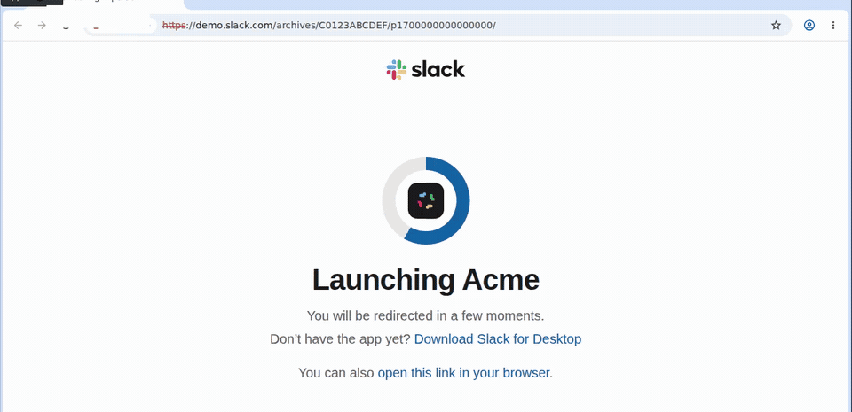

# Open Slack Links in Browser

The same clip is in [docs/demo.mp4](docs/demo.mp4).

Slack archive links open a Launching page that tries to start the desktop app. This extension sends those links to the web client instead.

The page's own "open this link in your browser" href is the same URL with `/archives/` replaced by `/messages/`. The extension does that swap before Slack can open `slack://`.

## Install

1. Open `chrome://extensions`.
2. Turn on Developer mode.
3. Click Load unpacked and pick this folder.

Chrome reads the extension from that path. Leave the folder where you loaded it.
After updating, use its Reload button in `chrome://extensions` to pick up changes,
including the toolbar icon.
Or run `python3 scripts/reload` to reload it without restarting Chrome.

The editable icon is `icons/icon.svg`. Rebuild the 16, 32, 48 and 128px PNGs with
`python3 scripts/build-icons.py` (requires ImageMagick).

## What it covers

`workspace.slack.com/archives/...` message and channel links, including query strings such as `thread_ts`. Enterprise Grid hosts (`*.enterprise.slack.com`) too.

`/ssb/redirect` and `/team/` pages do not have an `/archives/` path. On those, the extension follows the browser link on the page.

`app.slack.com` links are already the web client. Those are left alone.
